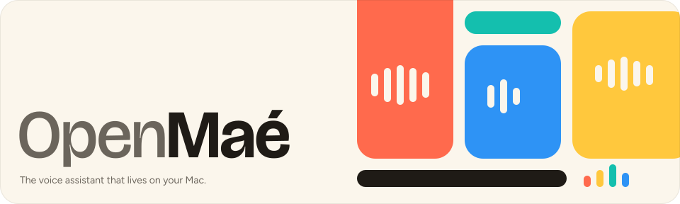
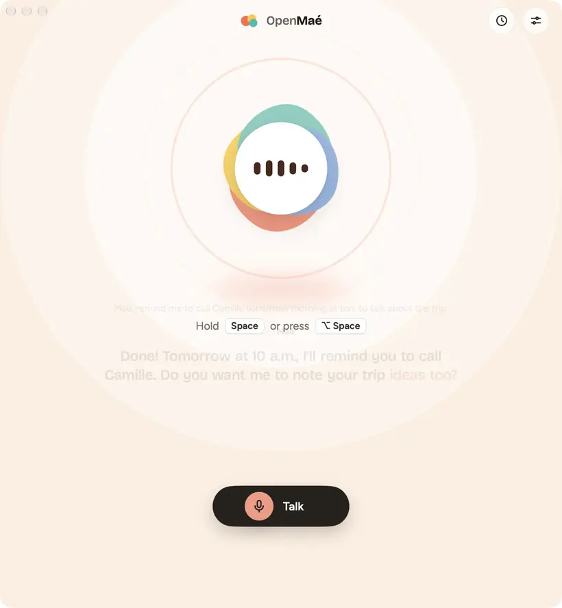

<p align="center">
  
</p>

**OpenMaé** is a voice assistant for Apple silicon Macs. You talk, Maé answers out loud, in French or English, in real
time — like the voice mode of the big chat apps, except that everything runs on your Mac: nothing you say leaves your
own devices.

<p align="center">
  
  <br><sub>You speak, Maé thinks, then answers out loud.</sub>
</p>

<p align="center">
  
  <br><sub>From any app: press ⌥ Space (by default), and a small capsule follows the conversation.</sub>
</p>

> **Status:** proof of concept, under active development. There is no signed download yet: for now the app is built
> from source (see below).

## Features

- **Real-time conversation.** Maé starts talking before her answer is fully written.
- **Interrupt her any time.** Just speak over her.
- **From any app.** Press ⌥ Space by default, or your own shortcut, and talk; a small capsule shows that she is
  listening.
- **« OK Maé ».** Hands-free: say her name, then what you want.
- **French first, English too.** She answers in the language you speak.
- **Actions.** Calendar events, reminders, timers and your own Shortcuts.
- **Searching the internet.** The news, opening hours, the weather, a travel time…
- **Memory.** She remembers what you ask her to.
- **From your iPhone.** Talk to Maé from anywhere; the work stays on the Mac.
- **Private by design.** Speech recognition, the language model and the voice all run on your Mac. No account, no
  telemetry: once the models are downloaded, only what you turn on goes online.

« OK Maé », the actions, the web search, the memory and the iPhone are off until you turn them on in Settings.

## Requirements

- A Mac with Apple silicon (M1 or later) and macOS 15 or later.
- Free disk space for the models, from 5.7 GB to 30 GB depending on the Mac (table below).

| Tier | Memory | Language model | First download | Status |
|---|---|---|---|---|
| Minimum | 8 GB | Gemma 4 E2B, 4-bit | 5.7 GB | untested, estimated |
| Standard | 16 to 24 GB | Gemma 4 E4B, 4-bit | 7.3 GB | untested, estimated |
| Comfort | 32 to 36 GB | Gemma 4 26B-A4B, 4-bit | 17.5 GB | tested (M1 Pro, 32 GB) |
| Maximum | 48 GB and more | Gemma 4 26B-A4B, 8-bit | 30.1 GB | untested, estimated |

Only the comfort tier could be measured so far. The app says so when it runs on another one.

## First launch

1. macOS asks for access to the microphone: click "Allow". Sound never leaves the Mac.
2. The app shows the Mac, its tier (another one can be picked from its menu), the models it needs with their
   size and license, the total to download and the free space, and waits for a click on "Download".
3. The download can be paused, or the app quit: it resumes where it stopped, and after a network cut it
   resumes by itself. Every file is checked against the SHA-256 recorded in the app: the models are pinned to
   the exact versions that were tested.
4. The first loading of the models takes one to two minutes (macOS prepares speech recognition for the
   chip), then about twenty seconds at each launch.

Settings › Advanced lists the models on the Mac with the space each one takes, and can delete another tier's
model on its own, or all of them.

## How it works

```
microphone ─► voice activity ─► speech recognition ─► language model ─► voice ─► speakers
              Silero VAD          Parakeet TDT v3        Gemma 4          Pocket TTS
              (CPU)               (Neural Engine)        (MLX, GPU)       (GPU)
```

- The end of your turn is detected after a short silence. During a pause in the middle of a sentence, the
  answer is already prepared, and dropped if you go on.
- While you speak, what you said so far is transcribed again about twice a second, so your words show under the orb;
  once your turn is over, the whole sentence is transcribed again, as it would be without them.
- Answers stream: each sentence goes to the voice as soon as it is written.
- The conversation stays in the model's memory between turns, so each answer only has to read your last
  sentence.

Measured on an M1 Pro with 32 GB:
- **End of your sentence → first sound:** about 1.6 s (median). The target is under 1 s, not reached yet:
  most of the delay is the voice getting started.
- **Interruption:** the voice stops about 0.25 s after you start speaking.
- **Memory:** about 16 GB in all, 14 GB of it for the language model.

The app (SwiftUI) and the engine (a Swift package) only talk through a small set of commands and events
(`Sources/VoiceCore/AssistantProtocol.swift`). The Apple-specific parts of the engine live in one target, so
porting to another platform means rewriting that target and the interface, not the conversation logic.

## iPhone app

The iPhone app (iOS 18 or later) talks to OpenMaé on your Mac: it is its microphone, its speaker and its screen,
while the models keep running on the Mac. A conversation started on one goes on on the other, it continues with
the screen locked, and whoever speaks last has it (the Mac's window shows "Maé is on your iPhone" and "Take over
here").

- **Pairing, once.** On the Mac, Settings › iPhone and iPad › "Add a device" shows a QR code, valid five minutes and
  usable once; scan it with the app. It carries the Mac's public key and a one-time code, after the `#` of a link
  (a browser never sends that part to a server).
- **At home**, the iPhone finds the Mac with Bonjour and talks to it directly over QUIC. The Mac and the iPhone
  each ask once for access to the local network (on the Mac, when you add your first iPhone).
- **Elsewhere**, both go through an OpenMaé relay (`relay/`, a small open-source server anyone can host): the
  Mac stays registered on it, the iPhone asks for it, and the relay passes their packets along. If UDP is
  blocked, a WebSocket over HTTPS takes over.
- **End-to-end encryption.** Noise (`IK` for sessions, `XXpsk3` for pairing; Curve25519, ChaChaPoly, SHA-256,
  checked against the official test vectors), keys in the keychain. A relay sees addresses and amounts of
  traffic, never a word or a sound. The protocol is in [relay/PROTOCOL.md](relay/PROTOCOL.md).
- **Sound.** Opus in 20 ms frames (Apple's own codec): 16 kHz from the iPhone's microphone, which removes the
  echo itself; 24 kHz for the voice, through a jitter buffer that conceals lost frames.
- **Powers.** The iPhone can talk, interrupt, start a new conversation and choose hands-free or hold-to-talk;
  downloading or deleting models, and quitting, stay on the Mac. Sensitive actions still ask for a spoken "yes".
- While an iPhone is paired, the Mac can stay awake when plugged in (Settings › iPhone and iPad › Sleep). An iPhone cannot
  wake a sleeping Mac.

Build it and install it on the iPhone connected to this Mac (with your Apple Developer team in
`App/Signing.local.xcconfig`):

```bash
zsh scripts/build-iphone.sh
```

`SIMULATOR=1 zsh scripts/build-iphone.sh` builds it for the simulator instead.

## Models and licenses

| Component | Role | License | Source |
|---|---|---|---|
| Silero VAD v6.2.1 | voice activity detection | MIT | CoreML export by aufklarer, shipped in the app |
| Parakeet TDT 0.6B v3 | speech recognition (25 European languages) | CC-BY-4.0 | NVIDIA; CoreML export by FluidInference |
| Gemma 4 (E2B, E4B, 26B-A4B) | language model | Apache-2.0 | Google; MLX conversions by mlx-community |
| Pocket TTS | voice ("estelle" in French, "alba" in English) | CC-BY-4.0 (weights), MIT (code) | Kyutai; CoreML export by FluidInference |
| [FluidAudio](https://github.com/FluidInference/FluidAudio) | runs the CoreML models | Apache-2.0 | |
| [mlx-swift-lm](https://github.com/ml-explore/mlx-swift-lm) | runs the language model | MIT | |
| [swift-transformers](https://github.com/huggingface/swift-transformers) | tokenizers | Apache-2.0 | |
| Bricolage Grotesque, Figtree | interface typefaces | SIL Open Font License 1.1 | shipped in the app with their license (`App/Resources/Fonts`) |

## Building from source

Requirements:
- Xcode 27 with its Metal Toolchain component: MLX compiles Metal shaders, which `swift build` cannot do.
- [XcodeGen](https://github.com/yonaskolb/XcodeGen), which generates the Xcode project from `App/project.yml`.

Install the two tools (once):

```bash
xcodebuild -downloadComponent MetalToolchain
```

```bash
brew install xcodegen
```

Build the app:

```bash
zsh scripts/build-app.sh
```

Launch it:

```bash
open .build/app/Build/Products/Release/OpenMae.app
```

The app's file name has no accent (`codesign` rejects one in an executable's name); macOS shows "OpenMaé"
through the localized display name.

The app is signed with your Apple Developer team: copy `App/Signing.local.xcconfig.example` to
`App/Signing.local.xcconfig` (ignored by git) and put your team ID in it. In a new git worktree,
`scripts/build-app.sh` copies that file from the main checkout. Without one, it stops rather than sign the app
for local use only (ad hoc): such a copy has the same bundle id as the normal app, so macOS asks again for the
microphone, calendars and reminders, and once they are allowed, the permissions move to that copy and leave the
normally signed app. `ADHOC=1 zsh scripts/build-app.sh` builds ad hoc on purpose. The script ends by printing the
identity the app is signed with.

To see a timestamped log of every stage, launch it with:

```bash
open --env VOICE_DEBUG=1 --stderr /tmp/openmae.log .build/app/Build/Products/Release/OpenMae.app
```

Build the engine and the command-line tool:

```bash
xcodebuild -scheme VoiceEngine-Package -destination 'platform=macOS,arch=arm64' -configuration Release -derivedDataPath .build/xcode -skipMacroValidation -skipPackagePluginValidation build
```

Run the tests:

```bash
xcodebuild test -scheme VoiceEngine-Package -destination 'platform=macOS,arch=arm64' -derivedDataPath .build/xcode -skipMacroValidation -skipPackagePluginValidation -only-testing:VoiceCoreTests -only-testing:OpenMaeLinkTests
```

The link's end-to-end tests (pairing, sessions, sound, on this Mac) use the network: they run with
`OPENMAE_NETWORK_TESTS=1` in the environment, and through a relay too with `OPENMAE_TEST_RELAY=<its URL>`
(see `relay/README.md` to run one locally).

## Command-line tool

`voice-cli` uses the same engine and the same models as the app, without any interface: it downloads the models,
measures the engine and runs the benchmarks. Its commands are in [Sources/VoiceCLI/README.md](Sources/VoiceCLI/README.md).

## Project layout

```
App/                         the macOS app (SwiftUI): screens only; its Xcode project is generated from
                             App/project.yml
iPhone/                      the iPhone app (SwiftUI), generated from iPhone/project.yml; it shares the design
                             files of App/Sources/Design and the live transcript with the Mac app
Package.swift                the voice engine, as a Swift package:
Sources/VoiceCore/             conversation logic, end-of-turn detection, text clean-up for the voice,
                               hardware tiers, model catalog and downloader, extension point
Sources/VoiceEngineApple/      the Apple implementations: Silero, Parakeet and Pocket TTS (CoreML),
                               Gemma 4 (MLX), microphone and speakers (AVAudioEngine)
Sources/OpenMaeLink/           the link with the iPhone: keys, pairing, Noise, direct and relayed connections,
                               the voice's codec and jitter buffer (both apps use it)
Sources/VoiceCLI/              voice-cli (its README lists the commands)
Tests/VoiceCoreTests/          unit tests of the core
Tests/OpenMaeLinkTests/        tests of the link (Noise test vectors, frames, jitter buffer, end to end)
Tests/Fixtures/                requests for the actions benchmark, Noise test vectors, recorded Claude Code
                               reports
relay/                       the OpenMaé relay (Go, Docker), its protocol and how to host one
scripts/                     build scripts, test phrases
```

The app's name is defined in one place for the engine (`Sources/VoiceCore/AppIdentity.swift`), and in
`App/project.yml` and `App/Resources/InfoPlist.xcstrings` for the app bundle.

## Uninstalling

Move the app to the Trash. To get back the space taken by the models, either use Settings › Advanced ›
"Delete the models…" first, or delete these folders by hand:
- `~/Library/Application Support/OpenMaé` (the models, and in its `Memory` folder what Maé remembers and the history
  of exchanges: "Delete the models…" leaves that folder alone, Settings › Memory › "Erase everything…" empties it);
- `~/Library/Caches/io.github.lgentilla.openmae` (the models compiled for the chip, about 2 GB).

The settings live in `~/Library/Preferences/io.github.lgentilla.openmae.plist`.

## License

No license has been chosen yet: until a license file is added, all rights are reserved. The models and
libraries keep their own licenses (table above).
